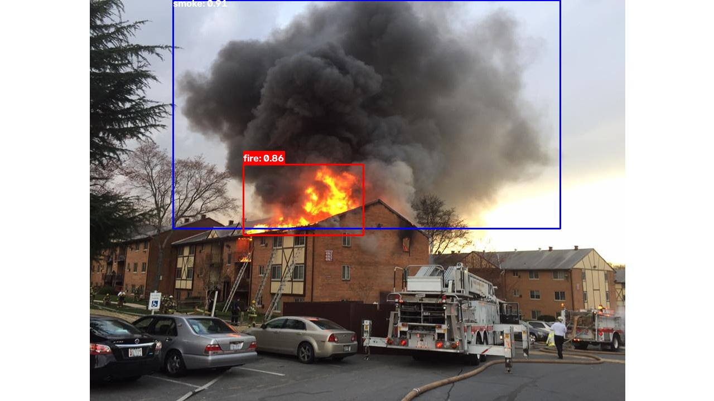

# Fire and Smoke Detection

Research of fire and smoke detection at the Computer Vision Laboratory of the Federal University of Santa Catarina (UFSC).

## Detections

### RT-DETR

>model: rtdetr | epochs: 40 | gpu: rtx 5090 | dataset: fasdd_cv 

## Articles

FASDD: An open flame and smoke detection dataset for deep learning in remote sensing based fire detection

>[document](articles/An%20open%20flame%20and%20smoke%20detection%20dataset%20for%20deep%20learning%20in%20remote%20sensing%20based%20fire%20detection.pdf), [dataset](https://www.scidb.cn/en/detail?dataSetId=ce9c9400b44148e1b0a749f5c3eb0bda)

---

## Structure
| Folder |  Description |
| --- | --- |
| models/ | trained models for fire and smoke detection |
| predict/ | predict samples |
| dataset/ | data samples |
| src/ | main.py code to run inference |